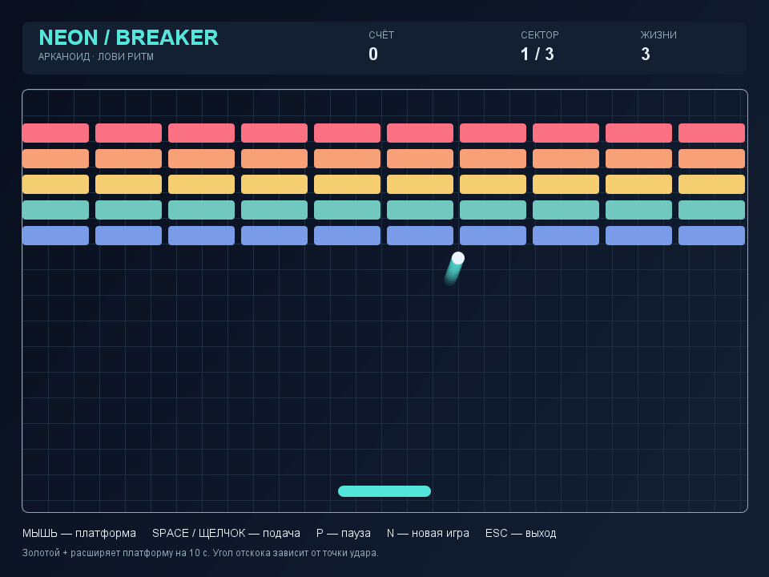

# Neon Breaker

Арканоид на Java Swing: три сектора, управление платформой мышью, прочные блоки и падающий бонус расширения платформы. Работает как отдельное настольное приложение, без браузера, сети и сторонних библиотек.



## Быстрый запуск

1. Полностью распакуйте архив.
2. Откройте папку `NeonBreaker` и запустите `START.cmd`.
3. Для подачи мяча нажмите пробел или левую кнопку мыши.

Требуется Java 17 или новее. Среда Java в проект не включена. Скрипт ищет Java в `JAVA_HOME`, `PATH` и стандартных папках Java / Eclipse Adoptium / Microsoft. Если Java установлена в другом месте, укажите её каталог в `JAVA_HOME` либо выполните команду с полным путём к `java.exe`.

Запуск из терминала в папке проекта:

```text
java -jar NeonBreaker.jar
```

JAR уже собран. Для игры компиляция не требуется. Если система сообщает `UnsupportedClassVersionError`, выбранная Java старее 17: укажите подходящий JDK в `JAVA_HOME`.

## Управление

| Действие | Управление |
|---|---|
| Переместить платформу | Движение мыши внутри игрового поля |
| Подать мяч | Пробел или левая кнопка мыши |
| Пауза / продолжить | P |
| Новая игра | N |
| Выйти | Esc или закрытие окна |

Клавиши N и P работают по физическому коду клавиши, в том числе при русской раскладке. При потере фокуса во время игры включается пауза. После возврата в окно нажмите P. Нажатие N полностью сбрасывает игру, в том числе во время паузы и после победы.

## Правила

- Разбейте все блоки на трёх уровнях. В начале игры есть три жизни.
- За каждый удар по блоку начисляется 10 очков. Блоки с белой рамкой выдерживают два удара; они появляются на втором и третьем уровнях.
- После очистки сектора мяч ждёт новой подачи. Счёт и оставшиеся жизни сохраняются.
- За каждый седьмой разрушенный блок появляется золотой бонус `+`, если другой бонус ещё не падает. Поймайте его платформой: она расширится на 10 секунд игрового времени. Повторный бонус обновляет длительность.
- Чем ближе удар к краю платформы, тем сильнее мяч отклоняется в сторону. Удар по центру направляет мяч вверх.
- Пропуск мяча отнимает одну жизнь. После потери всех жизней игра завершается. Полное прохождение трёх секторов означает победу.

## Сборка и проверка

Требуется именно JDK 17+, поскольку в нём есть компилятор `javac` и упаковщик `jar`.

```text
BUILD.cmd
TEST.cmd
```

`BUILD.cmd` компилирует исходники в `build` с UTF-8 и проверками `-Xlint:all`, затем создаёт `NeonBreaker.jar`. `TEST.cmd` компилирует исходники и тесты отдельно в `test-build` и выполняет 32 проверки без открытия окна. Успешный результат: `PASS: 32 checks`.

В Linux/macOS можно собрать и запустить без Windows-скриптов:

```sh
mkdir -p build
javac --release 17 -encoding UTF-8 -Xlint:all -d build src/neonbreaker/*.java
jar --create --file NeonBreaker.jar --main-class neonbreaker.Main -C build neonbreaker
java -jar NeonBreaker.jar
```

## Состав проекта

```text
NeonBreaker.jar                  готовое приложение
START.cmd                       запуск Windows
BUILD.cmd                       сборка Windows
TEST.cmd                        проверки Windows
find-java.cmd                   поиск Java
src/neonbreaker/                 исходники приложения
tests/neonbreaker/               автоматические проверки
README.md                       запуск, правила и управление
EXPLANATION.md                   устройство проекта и критерии
preview.png                     пример отрисовки игрового поля
```

## GitHub Actions

В `.github/workflows/java.yml` настроены сборка, 32 проверки и упаковка JAR на Java 17 и 21. Workflow запускается при push, pull request и вручную. После успешного выполнения готовые JAR доступны в разделе Actions как артефакты. Локальные каталоги сборки и настройки IDE исключены через `.gitignore`.

## Публикация на GitHub

Создайте пустой репозиторий `neon-breaker` без автоматически создаваемых README, лицензии и `.gitignore`. В локальной папке проекта уже инициализирована ветка `main` с начальным коммитом. Подключите адрес своего репозитория и отправьте ветку:

```sh
git remote add origin https://github.com/YOUR_USERNAME/neon-breaker.git
git push -u origin main
```

Замените `YOUR_USERNAME` своим логином. Если проект скачан как ZIP без каталога `.git`, сначала выполните:

```sh
git init -b main
git add .
git commit -m "Initial commit"
```

Описание для репозитория: `Арканоид на Java Swing: три уровня, бонусы и многопоточный игровой движок.`
